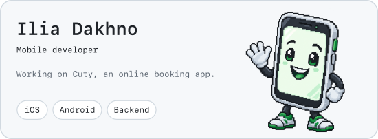
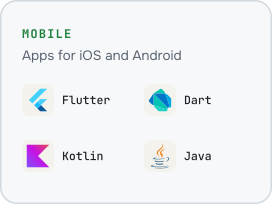
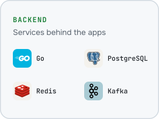
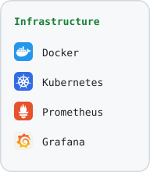

  <picture>
    <source media="(prefers-color-scheme: dark)" srcset="assets/hero-dark.svg">
    
  </picture>

  <picture>
    <source media="(prefers-color-scheme: dark)" srcset="assets/stack-mobile-dark.svg">
    
  </picture>
  <picture>
    <source media="(prefers-color-scheme: dark)" srcset="assets/stack-backend-dark.svg">
    
  </picture>
  <picture>
    <source media="(prefers-color-scheme: dark)" srcset="assets/stack-infra-dark.svg">
    
  </picture>

  <a href="https://t.me/dakhno_ilia">
    <picture>
      <source media="(prefers-color-scheme: dark)" srcset="assets/btn-telegram-dark.svg">
      
    </picture>
  </a>
  <a href="mailto:73265adk@gmail.com">
    <picture>
      <source media="(prefers-color-scheme: dark)" srcset="assets/btn-email-dark.svg">
      
    </picture>
  </a>
  <a href="https://t.me/ilia_dakhno_dev">
    <picture>
      <source media="(prefers-color-scheme: dark)" srcset="assets/btn-blog-dark.svg">
      
    </picture>
  </a>

  <picture>
    <source media="(prefers-color-scheme: dark)" srcset="assets/github-snake-dark.svg">
    
  </picture>

